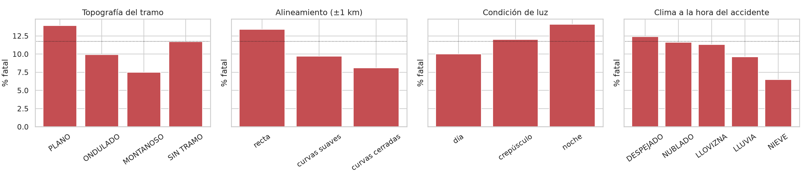
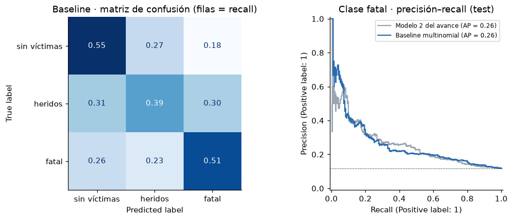

# Predicción del riesgo y la gravedad de accidentes en carreteras del Perú con datos abiertos y clima

**Curso:** Inteligencia Artificial Aplicada (1INF62) · PUCP · 2026-2
**Integrantes:** Marco Rodriguez, Angel Cerdán, Raul Malaver, Fernando De La Cruz

## Contenido
1. [Problema y objetivo](#1-problema-y-objetivo)
2. [Dataset](#2-dataset)
3. [Revisión de literatura](#3-revisión-de-literatura)
4. [Metodología y modelos](#4-metodología-y-modelos)
5. [Resultados](#5-resultados)
6. [Cómo ejecutar](#6-cómo-ejecutar)
7. [Estructura del repositorio](#7-estructura-del-repositorio)

---

## 1. Problema y objetivo

Los accidentes en carreteras causan muertes y heridos cada año en el Perú, y los recursos para atenderlos
(patrullas de la PNP, ambulancias, personal del Centro de Gestión y Monitoreo de SUTRAN) son limitados. Para
repartirlos hacen falta dos cosas: saber **dónde y cuándo habrá más accidentes** y, cuando llega un reporte,
saber **qué tan grave es** para priorizar el despacho.

> **Replanteo (noviembre de 2026).** En la presentación de avances, el proyecto preguntaba "¿cuánta mortalidad hay
> según la lluvia?" y lo respondía con asociaciones (chi², odds ratios, p-values): un problema de estadística
> inferencial. Ahora se plantea como **dos problemas de aprendizaje supervisado** con un uso operativo. El EDA y la
> literatura se usan para diseñar las variables, y la lluvia pasa a ser una variable más, cuyo aporte se mide con
> ablación.

**Objetivo general:** construir y comparar modelos de aprendizaje automático que (1) pronostiquen el riesgo diario
de accidentes por departamento y (2) clasifiquen la gravedad de un accidente al reportarse, integrando el registro
de SUTRAN con fuentes abiertas de clima y de infraestructura vial.

**Objetivos específicos**
- Integrar el registro de accidentes de SUTRAN con el clima diario y horario (Open-Meteo) y con los atributos de la
  Red Vial Nacional (MTC), para reconstruir las variables que la bibliografía asocia a la siniestralidad.
- Construir un panel departamento × día que incluya los días sin accidentes, para modelar la frecuencia.
- Entrenar y ajustar modelos lineales y de ensamble (Poisson, regresión logística, Random Forest y gradient
  boosting) y compararlos con referencias ingenuas, con validación temporal o cruzada repetida.
- Medir con ablación e importancia por permutación qué factores (tipo de choque, vía, clima, luz, calendario, lugar)
  aportan a la predicción.

| Tarea | Unidad | Pregunta (uso) | Objetivo | Se conoce |
|---|---|---|---|---|
| **1 · Pronóstico de riesgo** | departamento × día (15 336) | ¿Cuántos accidentes habrá mañana en cada departamento y habrá alguno fatal? (asignar patrullas y ambulancias) | `N_ACC` (conteo) y `HAY_FATAL` (binaria) | Historia hasta el día anterior, pronóstico de lluvia y calendario |
| **2 · Triaje de gravedad** | accidente (8 100) | Llegó un reporte: ¿es sin víctimas, con heridos o fatal? (priorizar el despacho) | `GRAVEDAD` ∈ {sin víctimas, heridos, fatal} | Tipo de choque, lugar, vía, clima y luz al momento del reporte |

---

## 2. Dataset

### 2.1 Origen y permisos
- **Nombre:** Accidentes de Tránsito en Carreteras (2020-2021).
- **Fuente:** Superintendencia de Transporte Terrestre de Personas, Carga y Mercancías (**SUTRAN**), publicado en la Plataforma Nacional de Datos Abiertos del Estado Peruano: <https://www.datosabiertos.gob.pe/dataset/accidentes-de-tr%C3%A1nsito-en-carreteras>
- **Contenido:** accidentes en vías nacionales y departamentales reportados por la Policía Nacional del Perú (PNP) y el Centro de Gestión y Monitoreo (CGM) de SUTRAN. Cada fila es un accidente.
- **Corte de la información:** 22/12/2021 (`FECHA_CORTE = 20211222`); el portal indica última modificación el 28/01/2022.
- **Licencia:** Open Data Commons Attribution (ODC-By). Es un dato público sin datos personales; se puede usar citando la fuente. No se requiere consentimiento adicional.
- **Tamaño:** 8 155 registros y 9 columnas en el CSV original. En la limpieza se descartan 3 sin dato de fallecidos, 7 sin departamento (sin departamento no se puede asignar lluvia) y 35 duplicados exactos; quedan **8 110 registros**, todos con dato de lluvia. El dataset limpio de la Tarea 2 (`data/processed/accidentes.csv`) excluye además 5 accidentes cuya gravedad no se conoce (sin dato de heridos y sin fallecidos): **8 105 accidentes × 33 columnas**. El panel de la Tarea 1 (`data/processed/panel_depto_dia.csv`) usa los 8 110.
- **Periodo real de los accidentes:** 01/01/2020 – 30/09/2021. La fecha de corte es el 22/12/2021, pero el archivo no contiene accidentes posteriores al 30/09/2021.
- **Archivo en el repo:** `data/raw/accidentes_transito_carreteras.csv` y su diccionario oficial en `data/raw/diccionario_de_datos.docx`.

### 2.2 Variables (según el diccionario de datos oficial)

| Variable | Descripción | Tipo | Tamaño | Observaciones del diccionario |
|---|---|---|---|---|
| `FECHA_CORTE` | Fecha de corte de la información | Numérico (AAAAMMDD) | 8 | |
| `FECHA` | Fecha del accidente de tránsito | Numérico (AAAAMMDD) | 8 | |
| `HORA` | Hora del accidente (HH:MM) | Numérico | 5 | "N.I." = no identificado: 88 accidentes sin hora |
| `DEPARTAMENTO` | Departamento donde ocurrió el accidente | Texto | 13 | 7 accidentes sin departamento |
| `CODIGO_VIA` | Código de la vía donde se reportó el accidente | Alfanumérico | 6 | 46 accidentes sin código de vía |
| `KILOMETRO` | Kilómetro de la vía donde se reportó el accidente | Numérico | 4 | 45 accidentes sin kilómetro |
| `MODALIDAD` | Atropello, choque, despiste, especial, volcadura o N.I. | Texto | 9 | 28 accidentes sin modalidad |
| `NUM_FALLECIDOS` | Número de personas reportadas como fallecidas | Numérico | 2 | 3 accidentes sin dato de fallecidos |
| `NUM_HERIDOS` | Número de personas reportadas como heridas | Numérico | 2 | 10 accidentes sin dato de heridos |

**Diferencias entre el diccionario y el archivo real** (el notebook las corrige automáticamente):
- En el CSV, las columnas se llaman `CODIGO_VM-MA` (encabezado con la tilde dañada, equivale a `CODIGO_VIA`), `FALLECIDOS` y `HERIDOS`.
- Separador `;`, codificación ISO-8859-1 (latin-1) y saltos de línea CRLF.
- Fecha como `AAAAMMDD` y hora como `HH:MM`.
- Los valores "N.I." se tratan como datos faltantes.

### 2.3 Datasets complementarios: ubicación, vía y clima
El registro de accidentes no tiene clima ni coordenadas, pero sí vía (`CODIGO_VIA`) y kilómetro.

- **Ubicación — Red Vial Nacional del MTC** (al 31/12/2014), publicada como servicio de mapas en el catálogo geoespacial de INGEMMET (<https://geocatmin.ingemmet.gob.pe/arcgis/rest/services/SERV_OTRAS_FUENTES/MapServer/23>). Cada tramo trae su ruta, su km de inicio y fin y su departamento. Con la vía y el kilómetro de cada accidente se interpola su posición sobre el tramo; el punto se acepta solo si el tramo está en el mismo departamento del accidente (o a ≤ 10 km de su límite). Así se ubica el **80.2 %** de los accidentes; el resto (vías departamentales, km "N.I." o km que no coincide con el kilometraje del MTC) usa la capital de su departamento. Copia en `data/raw/red_vial_nacional_mtc.json`.
- **Atributos de la vía — misma capa del MTC.** Del tramo en el que cae cada accidente se toman la topografía
  (plano / ondulado / montañoso), la superficie de rodadura (dominio de la capa: asfaltado, asfaltado económico,
  afirmado, sin afirmar, trocha, proyectada), su estado, el número de carriles, el ancho de calzada, la velocidad
  promedio del tramo y la región natural. Además se calcula la **sinuosidad** en ±1 km del punto (largo del camino /
  distancia en línea recta), como medida del alineamiento.
- **Precipitación — API histórica de Open-Meteo** (<https://open-meteo.com/en/docs/historical-weather-api>), gratuita para uso no comercial, sin API key y con atribución. Se descarga la precipitación diaria (`precipitation_sum`, en mm) en la **celda de 0.1° (~11 km)** que contiene a cada accidente y se une por **celda + fecha**; la API también da la **altitud** de la celda (`ELEVACION`). Copia en `data/raw/clima_celdas_open_meteo.csv`. Para cada accidente con hora se descarga también el **clima por hora** en su celda (`data/raw/clima_horario_celdas.csv`): código WMO agrupado (despejado / nublado / neblina / llovizna / lluvia), lluvia de la hora y de las 3 horas alrededor, nubosidad, temperatura, viento, neblina (temperatura − punto de rocío < 2 °C) y, con la salida y la puesta del sol del día, si era de día, de noche o crepúsculo. Se conserva además la lluvia en la capital del departamento (`PRECIP_CAPITAL`, `data/raw/clima_open_meteo.csv`) para comparar.

### 2.4 Limitaciones del dataset
- **Resolución espacial de la lluvia:** el dataset no trae coordenadas; la ubicación se reconstruye con la vía y el kilómetro. El 19.8 % de los accidentes no se puede ubicar y usa la lluvia de la capital de su departamento, y la lluvia se mide en celdas de ~11 km, no en el punto exacto.
- **Kilometraje:** la capa de vías es de 2014 y en algunas rutas el kilómetro reportado por SUTRAN no coincide con el kilometraje oficial del MTC (1 059 accidentes se dejan con la capital por esa razón).
- **Origen de la lluvia:** los valores de la API provienen de datos de reanálisis, no de estaciones; pueden diferir de las mediciones de SENAMHI, sobre todo en la zona andina.
- **Solo accidentes:** el registro no tiene días sin accidentes ni tráfico. Los días sin accidentes se reconstruyen en el panel departamento × día (Tarea 1); la exposición (vehículos que circulan) sigue sin conocerse.
- **Sin datos del vehículo ni de las personas:** tipo de vehículo, uso de cinturón, edad o alcohol, que son los factores más importantes en Babaoglu y Babaoglu (2021) y Emu et al. (2022), no existen en el registro.
- **Periodo enero 2020 – septiembre 2021:** coincide con la pandemia (restricciones de movilidad); en el EDA, abril de 2020 cae a ≈ 20 fallecidos, coherente con la cuarentena.
- **Datos faltantes y posible subregistro** (valores "N.I.").

---

## 3. Revisión de literatura

Cada integrante revisó un artículo revisado por pares sobre predicción de fatalidad o gravedad, o sobre búsqueda de patrones en accidentes viales, que no usa el mismo dataset que nosotros. Los PDF están en [`papers/`](papers/) (índice en [`papers/README.md`](papers/README.md)).

### Paper 1 · Marco Rodriguez · [`paper_integrante1.pdf`](papers/paper_integrante1.pdf)
**K. V. Mhetre y A. D. Thube**, "Count Data Modeling for Predicting Crash Severity on Indian Highways", *Engineering, Technology & Applied Science Research*, vol. 13, n.º 5, pp. 11816-11820, 2023. DOI: [10.48084/etasr.6172](https://doi.org/10.48084/etasr.6172)

- **Problema:** predecir la fatalidad de accidentes en una carretera nacional rural de la India (NH-48, Maharashtra, ~265 km) según la naturaleza del choque, el horario (AM/PM) y el clima.
- **Datos:** registros de la National Highways Authority of India, 2016-2020. División 70 % entrenamiento / 30 % validación.
- **Técnica:** regresión **binomial negativa** (extiende Poisson a conteos con sobredispersión). Cuatro modelos: naturaleza del choque, horario, condición climática (fino, nublado, llovizna, lluvia fuerte, neblina) y choque + horario. Validación con log-verosimilitud, AIC, BIC, MAD, MSE, RMSE y MAPE.
- **Resultados:** la naturaleza del choque y el clima resultaron significativos; lluvia ligera y fuerte, neblina, tiempo fino y nublado aparecen asociados positivamente con la fatalidad. Los modelos 2 y 4 ajustaron mejor.
- **Aporte a nuestro proyecto:** respalda modelar `NUM_FALLECIDOS` como **conteo** (usamos Poisson como baseline y proponemos binomial negativa para el final) y confirma el clima como variable relevante. **Crítica:** usa el clima como categorías y no aísla un efecto propio de la lluvia; nosotros usamos precipitación continua en mm y evaluamos en datos de prueba.

### Paper 2 · Angel Cerdán · [`paper_integrante2.pdf`](papers/paper_integrante2.pdf) (resumen de una página: [`paper_integrante2_resumen.pdf`](papers/paper_integrante2_resumen.pdf))
**E. G. Muñoz Muñoz, D. A. Verduga Alcívar, Y. F. Guerrero Alcívar, M. A. Lapo Palacios y O. Zorrilla Briones**, "Búsqueda de patrones con machine learning en datos de siniestros de tránsito", *Ciencia Latina Revista Científica Multidisciplinar*, vol. 8, n.º 2, pp. 1617-1637, 2024. DOI: [10.37811/cl_rcm.v8i2.10592](https://doi.org/10.37811/cl_rcm.v8i2.10592)

- **Problema:** identificar patrones en los siniestros de tránsito (lugar, hora, causa, condiciones del entorno) para orientar intervenciones de seguridad vial focalizadas. Es un análisis **no supervisado**: no hay etiqueta que predecir.
- **Datos:** 21 352 siniestros de la base de la Agencia Nacional de Tránsito (organizada por provincia y cantón, como en Ecuador). 12 columnas: año, mes, día, hora, provincia, cantón, zona, clase de siniestro, causa, número de fallecidos, número de lesionados y total de víctimas. El artículo no precisa el periodo cubierto.
- **Técnicas:**
  - *Preprocesamiento:* limpieza (faltantes, errores tipográficos en categóricas, duplicados), normalización de las variables numéricas y **codificación binaria** de las categóricas (de 11 a 39 variables).
  - *EDA:* distribuciones por mes, día de la semana, zona, clase, causa y hora; **mapa coroplético** de siniestros por zona y **diagrama de Sankey** tiempo → causa/ubicación → víctimas.
  - *Clustering:* **K-Means** (minimiza la suma de distancias cuadradas dentro del cluster, WCSS). El número de clusters se eligió con el **método del codo** (inflexión entre 3 y 5) y el **análisis de silueta**; se fijó K = 4.
  - *Reducción de dimensionalidad:* **PCA** de 39 a 2 y 3 componentes para visualizar los clusters.
  - *Complemento supervisado:* **Random Forest** con gráfico de **importancia de variables** y visualización de un **árbol de decisión** individual del bosque.
- **Resultados:** cuatro clusters: (0) urbano, tarde/noche, distracción del conductor (5 563 casos); (1) rural, fines de semana, noche/madrugada, exceso de velocidad y alcohol (3 560); (2) intersecciones urbanas en horas punta, incumplimiento de señales (6 317); (3) carreteras y zonas periurbanas con mal estado de la vía y **clima adverso** (5 912). En el Random Forest las variables más importantes fueron el número de lesionados y el total de víctimas, seguidas de provincia, cantón, mes y hora.
- **Aporte a nuestro proyecto:** el cluster 3 (carreteras + clima adverso) es justamente nuestro caso de estudio y respalda incluir el clima y la ubicación. Tomamos dos ideas: (a) agrupar con **K-Means** los departamentos (o vías) según su régimen de lluvia y su siniestralidad, y usar el cluster como variable espacial más compacta que el one-hot de 25 departamentos; (b) usar **PCA** en el EDA para visualizar la estructura de los accidentes y la **importancia de variables** de modelos de árboles para ordenar los predictores. También valida el preprocesamiento que ya hacemos (limpieza de "N.I.", codificación de categóricas, escalado).

### Paper 3 · Raul Malaver · [`paper_integrante3.pdf`](papers/paper_integrante3.pdf)
**L. Babaoglu y C. Babaoglu**, "Prediction of Fatalities in Vehicle Collisions in Canada", *Promet – Traffic&Transportation*, vol. 33, n.º 5, 2021. DOI: [10.7307/ptt.v33i5.3782](https://doi.org/10.7307/ptt.v33i5.3782)

- **Problema:** predecir si un accidente tendrá fallecidos y descubrir las causas de la fatalidad en las carreteras de Canadá.
- **Datos:** National Collision Database de Canadá, 1999-2017.
- **Técnicas:** análisis exploratorio con minería de datos y **reglas de asociación** para hallar factores clave; luego dos clasificadores supervisados, **regresión Lasso** (regresión con penalización L1 que selecciona variables) y **XGBoost** (árboles con *boosting*). Se interpretan las variables más importantes del modelo ganador.
- **Resultados:** XGBoost fue el mejor clasificador con 83 % de exactitud. Las variables más importantes fueron la configuración de la colisión y el uso de dispositivos de seguridad, por encima de año del vehículo, hora, edad o sexo. Los choques frontales fuera de intersecciones y sin control de tránsito resultaron los más letales, y **la mayoría de las muertes ocurre con clima y condiciones de vía no extremos**.
- **Aporte a nuestro proyecto:** ejemplo de pipeline EDA + Lasso + XGBoost y de interpretación por importancia de variables. Su hallazgo sobre clima no extremo es un contrapunto a nuestra hipótesis: conviene controlar por exposición y por departamento antes de atribuir efectos a la lluvia.
- **Limitación:** la exactitud sola no es suficiente con clases desbalanceadas.

### Paper 4 · Fernando De La Cruz · [`paper_integrante4.pdf`](papers/paper_integrante4.pdf)
**M. Emu et al.**, "Fatality Prediction for Motor Vehicle Collisions: Mining Big Data Using Deep Learning and Ensemble Methods", *IEEE Open Journal of Intelligent Transportation Systems*, 2022. DOI: [10.1109/OJITS.2022.3160404](https://doi.org/10.1109/OJITS.2022.3160404)

- **Problema:** predecir si el resultado de una colisión será fatal o no, como base de un posible sistema de alerta en tiempo real.
- **Datos:** base de choques de Canadá con 5.8 millones de registros.
- **Técnicas:** ensambles por **votación mayoritaria y soft voting** para tratar el desbalance de clases, y **redes neuronales convolucionales (CNN)**; además un análisis del contenido de información de cada atributo para identificar los factores que más distinguen choques fatales de no fatales.
- **Resultados:** exactitud cercana al 75 % con CNN. Los factores más influyentes incluyen las características de la vía y **las condiciones climáticas al momento del choque**, tipo de vehículo, hora, clase y posición del usuario, uso de dispositivos de seguridad y estado del control de tránsito.
- **Aporte a nuestro proyecto:** respalda usar redes neuronales (MLP) y ensambles, e incluir el clima como variable de entrada; sugiere medir la importancia de cada variable.
- **Limitación:** conjunto de datos y contexto muy distintos (Canadá, millones de registros); la exactitud ~75 % sola no refleja el desbalance.

### 3.1 Técnicas encontradas

| Técnica | Dónde aparece | Para qué sirve |
|---|---|---|
| Regresión binomial negativa / Poisson | Mhetre y Thube | Modelar conteo de fallecidos con sobredispersión |
| Lasso (regresión con penalización L1) | Babaoglu | Selección de variables y clasificación |
| XGBoost (*boosting*) | Babaoglu | Mejor clasificador del paper (83 % de exactitud) |
| Random Forest y árbol de decisión | Muñoz et al. | Clasificación e interpretación (importancia de variables, lectura de un árbol) |
| CNN y ensambles por votación | Emu et al. | Clasificación con grandes volúmenes y desbalance |
| K-Means + método del codo y silueta | Muñoz et al. | Agrupar accidentes o zonas con perfiles similares; elegir K |
| PCA | Muñoz et al. | Reducir dimensionalidad y visualizar en 2D/3D |
| Codificación de categóricas y normalización | Muñoz et al. | Preparar variables para modelos basados en distancia |
| Mapa coroplético y diagrama de Sankey | Muñoz et al. | EDA espacial y de flujos tiempo → causa → víctimas |
| Reglas de asociación | Babaoglu | Descubrir factores de riesgo en el EDA |
| Importancia de variables / contenido de información | Muñoz et al., Babaoglu, Emu et al. | Ordenar variables por su relación con la fatalidad |
| AIC, BIC, MAD, RMSE, MAPE | Mhetre y Thube | Evaluar modelos de conteo |

---

## 4. Metodología y modelos

**Flujo**
1. **Preprocesamiento** (`00_preprocesamiento.ipynb`; las mismas funciones están en `src/preprocessing.py`, que se
   ejecuta con `python -m src.preprocessing`):
   - limpieza del CSV de SUTRAN;
   - ubicación de cada accidente por vía y km sobre la Red Vial Nacional, con los atributos de su tramo;
   - clima diario y por hora en su celda, y la condición de luz;
   - variables derivadas;
   - selección de variables y encoding.

   Salen dos datasets limpios:
   - `accidentes.csv`: 8 105 × 33, Tarea 2;
   - `panel_depto_dia.csv`: 15 336 × 25, Tarea 1.
2. **EDA** (`01_eda.ipynb`): trabaja solo sobre los datasets limpios. Cubre la gravedad frente al tipo de choque,
   el lugar, la hora, la vía, la luz y el clima, y el panel (ceros, memoria, cuarentena, lluvia). Cada hallazgo se
   traduce en una decisión de modelado.
3. **Baseline** (`02_modelos.ipynb`): por cada tarea, una referencia sin aprendizaje y un modelo lineal con todas las
   variables, sin ajuste de hiperparámetros.
4. **Siguientes pasos** (issues del repositorio):
   - Random Forest y gradient boosting;
   - ajuste de hiperparámetros con la misma validación;
   - ablación por grupos de variables e importancia por permutación;
   - informe y presentación finales.

### 4.1 Variables (factores de la bibliografía → columnas)

Los grupos están en `src/models.py` (`GRUPOS_T1`, `GRUPOS_T2`) y son la unidad de la ablación.

| Grupo | Factor en la bibliografía | Variables | Tarea |
|---|---|---|---|
| Tipo de choque | Naturaleza / configuración del choque (Mhetre; Babaoglu; Emu) | `MODALIDAD` | 2 |
| Vía | Alineamiento, superficie, configuración, velocidad (Babaoglu; Emu) | `TOPOGRAFIA`ᵒ, `SUPERFICIE`ᵒ, `ESTADO_VIA`ᵒ, `SINUOSIDAD`, `CARRILES`, `ANCHO_CALZADA`, `VEL_PROMEDIO_TRAMO`, `TIPO_VIA`, `UBICACION` | 2 |
| Clima | Condición climática por categorías (Mhetre; Babaoglu; Emu) | Diario: `PRECIP_LOG`, `HORAS_LLUVIA`; por hora: `CLIMA_HORA`, `PRECIP_3H_LOG`, `NEBLINA`. Tarea 1: lluvia del día y acumulada de 3 y 7 días en la capital | 1 y 2 |
| Luz y hora | Condición de luz y hora (Emu; Muñoz) | `ES_DE_DIA`, `CREPUSCULO`, `HORA_SIN`/`HORA_COS` | 2 |
| Calendario | Mes, fin de semana, feriados (Muñoz, cluster 1) | `MES_SIN`/`MES_COS`, `FIN_DE_SEMANA`, `FERIADO`, `PUENTE`, `CUARENTENA` | 1 y 2 |
| Lugar | Provincia / cantón, zona (Muñoz) | `DEPARTAMENTO`, `REGION_NATURAL`, `ELEVACION`, `DIST_CAPITAL_KM`; Tarea 1: `ALTITUD_MEDIA` | 1 y 2 |
| Historia | Variación semanal de los choques (Mhetre, trabajos relacionados) | `N_ACC_AYER`, `N_ACC_SEMANA_PASADA`, `N_ACC_M7`, `N_ACC_M28`, `N_FATALES_M28`, `N_HERIDOS_M28`, `P_ATROPELLO_M28`, `P_CHOQUE_M28` (todas hasta *t − 1*) | 1 |

ᵒ = ordinal (una columna: plano < ondulado < montañoso; muy buena → mala; asfaltado → trocha).

**Decisiones de selección y encoding** (12/11/2026; detalle en `00_preprocesamiento.ipynb` §7). Para que el encoding no
sea excesivo, ya que antes eran 135 columnas en la Tarea 2:
- **Salen del modelo:** `CODIGO_VIA` (174 vías, cubiertas por los atributos del tramo), `FRANJA` (repite la hora),
  `DIA_SEMANA` (ya está `FIN_DE_SEMANA`), `TEMPERATURA`, `VIENTO` y `NUBOSIDAD` (sin respaldo ni señal), y `LAT`/`LON`
  (se superponen con el departamento).
- **Codificación:**
  - topografía, estado y superficie son ordinales;
  - `DEPARTAMENTO`, `MODALIDAD`, `CLIMA_HORA`, `REGION_NATURAL` y `TIPO_VIA` van en one-hot, con las categorías de
    < 30 casos agrupadas;
  - las binarias ocupan una sola columna.

  El encoding se aplica dentro del pipeline de cada modelo (`src/models.py::preprocesador`), así que se ajusta solo con
  el train de cada pliegue.
- **Resultado:** **67 columnas** en la Tarea 2 y 43 en la Tarea 1.

**Sin fuga de información.**
- En la Tarea 1, toda la historia se desplaza un día. El preprocesamiento lo verifica con un `assert`.
- En la Tarea 2, `NUM_HERIDOS` y `NUM_FALLECIDOS` solo forman parte del objetivo (`GRAVEDAD`), nunca son variables de entrada.

### 4.2 Modelos

| Modelo | Tarea | Respaldo | Estado |
|---|---|---|---|
| Referencias sin ML: media de 28 días, semana pasada, fatales de 28 días, Dummy | 1 y 2 | Lo que hay que superar | **Implementado** |
| Regresión de Poisson | 1 · `N_ACC` | Mhetre y Thube (2023) | **Implementado (baseline)** |
| Regresión logística (binaria / multinomial) | 1 · `HAY_FATAL`, 2 | Curso; Babaoglu (Lasso) | **Implementado (baseline)** |
| Random Forest (`criterion="poisson"` en la Tarea 1) | 1 y 2 | Muñoz et al. (2024) | Factoría lista en `src/models.py`; pendiente (issue) |
| Gradient boosting (`HistGradientBoosting`, pérdida de Poisson en la Tarea 1, categóricas nativas) | 1 y 2 | Babaoglu y Babaoglu (2021) (XGBoost) | Factoría lista en `src/models.py`; pendiente (issue) |
| MLP y ensamble por votación | 2 | Emu et al. (2022) | Opcional (issue) |
| Ablación por grupos + importancia por permutación | 1 y 2 | Muñoz; Babaoglu; Emu (importancia de variables) | Pendiente (issue) |

### 4.3 Validación y métricas

| Tarea | Validación | Métrica principal | Otras |
|---|---|---|---|
| 1 · `N_ACC` | Origen móvil por fechas (`E.cv_temporal`: 5 bloques tras 180 días de entrenamiento) y **holdout abr–sep 2021** | **D² de Poisson** (fracción de devianza explicada; 0 = predecir la media) | Devianza de Poisson, MAE, RMSE |
| 1 · `HAY_FATAL` | Igual | **PR-AUC** (al azar = 0.058) | ROC-AUC, Brier (calibración) |
| 2 · `GRAVEDAD` | CV estratificada **repetida 5 × 5** (los mismos pliegues para todos) y test 80/20 | **Macro-F1** | Balanced accuracy, PR-AUC de la clase fatal (al azar = 0.117), log-loss, matriz de confusión |

- **La exactitud no se usa:** el 66 % de los departamento-días tiene 0 accidentes y solo el 11.7 % de los accidentes es fatal.
- **El MAE no decide en la Tarea 1:** premia predecir 0.
- **La validación de la Tarea 1 es temporal** porque la serie tiene memoria y cambia de nivel con la cuarentena. Una partición aleatoria mezclaría el futuro con el pasado.
- **Comparación entre modelos:** se hace pliegue a pliegue (`E.comparacion_pareada`).

---

## 5. Resultados

### 5.1 EDA (`01_eda.ipynb`)
- **Datos:** 8 110 accidentes (ene 2020 – sep 2021), de los cuales:
  - 36 % sin víctimas, 52 % con heridos y 11.7 % fatales;
  - 80.2 % ubicados por vía y km;
  - todos con clima en su celda, y los que tienen hora, con clima por hora.
- **Panel:** el 66 % de los departamento-días no tiene accidentes y el 5.8 % tiene alguno fatal. La serie tiene
  memoria y cae con la cuarentena (abril de 2020). Con 5–10 mm de lluvia en la capital hay ≈ 23 % más accidentes que
  el promedio del departamento. La relación es débil y no monótona, pero existe, a diferencia de lo que pasa con la gravedad.
- **Gravedad (% de accidentes fatales):**
  - **Tipo de choque:** atropello 42.9 %, despiste 7.4 %.
  - **Luz:** noche 14.1 %, día 10.0 %.
  - **Alineamiento:** rectas 13.4 %, curvas cerradas 8.1 %.
  - **Relieve:** plano 13.9 %, montañoso 7.5 %. Coincide con Babaoglu (2021), que encuentra la mayoría de muertes
    en vías rectas y niveladas; una explicación probable es la velocidad.
  - **Clima por categorías:** casi no cambia el % fatal.

  

### 5.2 Baseline (`02_modelos.ipynb`, `results/metrics.csv`)

**Tarea 1 · `N_ACC`** (D² de Poisson; más es mejor)

| Modelo | CV temporal (5 pliegues) | Holdout abr–sep 2021 |
|---|---|---|
| Ingenuo · semana pasada | −4.650 | −4.610 |
| Ingenuo · media 28 días | 0.217 | **0.277** |
| **Baseline · Poisson** | **0.256** | 0.267 |

**Tarea 1 · `HAY_FATAL`** (PR-AUC; al azar ≈ 0.06)

| Modelo | CV temporal | Holdout | ROC-AUC holdout |
|---|---|---|---|
| Ingenuo · fatales últimos 28 días | 0.112 | 0.131 | 0.689 |
| **Baseline · Reg. logística** | **0.133** | **0.161** | **0.734** |

**Tarea 2 · `GRAVEDAD`** (CV 5 × 5)

| Modelo | Macro-F1 | Balanced acc. | PR-AUC fatal | Log-loss |
|---|---|---|---|---|
| Dummy (proporciones) | 0.228 | 0.333 | 0.117 | 0.960 |
| Modelo 2 del avance (depto + hora + altitud + modalidad) | **0.421** | **0.469** | **0.269** | 1.037 |
| **Baseline · Reg. logística multinomial (67 columnas)** | 0.419 | 0.466 | 0.266 | 1.037 |



### 5.3 Lectura del baseline
- **Tarea 1 · conteo:** el Poisson le gana a la media móvil en los 5 pliegues de la CV (+0.039 de D², IC 95 % aprox.
  +0.025 a +0.053). En el holdout queda empatado o un poco por debajo (0.267 frente a 0.277). Hay señal
  aprendible más allá de la inercia, pero un modelo lineal apenas la captura. Las interacciones no lineales (departamento
  × calendario, lluvia × región) son lo siguiente que hay que probar.
- **Tarea 1 · `HAY_FATAL`:** la logística mejora a la referencia en CV (+0.021, mejor en 4 de 5 pliegues) y en el holdout
  (PR-AUC 0.161, 2.4 veces el azar; ROC-AUC 0.734).
- **Tarea 2:** pasar de las 4 variables del avance a todas (67 columnas tras el encoding) con un modelo **lineal**
  deja el resultado igual: −0.002 de macro-F1, mejor en 10 de 25 pliegues. Con 135 columnas, antes de la reducción,
  quedaba algo peor (−0.004). Sin interacciones, las variables nuevas no suman. Ese es el argumento para los ensambles de
  árboles: deben mostrar si la vía, el clima y la luz aportan cuando se permiten interacciones, por ejemplo atropello de
  noche en recta.
- **El triaje sigue siendo difícil:** en el test, el baseline detecta el 51 % de los fatales con una precisión de 0.21. Los heridos
  y los sin víctimas se confunden entre sí, porque el registro no trae vehículo, ocupantes ni velocidad.

### 5.4 Siguientes pasos (issues)
Cada issue trae su contexto, los pasos y los criterios de aceptación. Las convenciones comunes están en `AGENTS.md`.

| Issue | Qué | Depende de |
|---|---|---|
| #2 | Tarea 1 · Random Forest y gradient boosting para `N_ACC` (CV temporal + ajuste de hiperparámetros) | — |
| #3 | Tarea 1 · Clasificadores de `HAY_FATAL` con calibración | — |
| #4 | Tarea 2 · Random Forest y gradient boosting multiclase (ajuste + desbalance) | — |
| #5 | Ablación por grupos de variables e importancia por permutación | #2, #3, #4 |
| #6 | Investigar una variable de exposición (flujo vehicular en peajes) | — |
| #7 | `model_comparison.txt` final, README §5 y reproducibilidad | #2–#5 |
| #8 | `report.pdf` (3–5 páginas) | #7 |
| #9 | Presentación final (`presentation.pdf`) | #7 |
| #10 | Opcional: MLP y ensamble por votación (Emu et al.) | #4 |

---

## 6. Cómo ejecutar

```
uv venv --python 3.12 .venv && uv pip install -r requirements.txt   # o: python -m venv .venv && pip install -r requirements.txt
cd notebooks && ../.venv/bin/jupyter nbconvert --to notebook --execute --inplace 00_preprocesamiento.ipynb 01_eda.ipynb 02_modelos.ipynb
```

1. `00_preprocesamiento.ipynb`: limpieza, ubicación, atributos de la vía, clima, variables, selección y encoding.
   Guarda `data/processed/accidentes.csv` y `panel_depto_dia.csv`. Equivale a `python -m src.preprocessing`.
2. `01_eda.ipynb`: EDA sobre los datasets limpios (figuras `eda_*`).
3. `02_modelos.ipynb`: baselines de las dos tareas, `results/metrics.csv` y figuras `modelo_*`.

Las descargas externas están en `data/raw/` como cachés: red vial con atributos, clima por celda (diario y por
hora) y clima por capital. Con ellas, todo corre sin internet. Si se borran, se vuelven a descargar: el clima por hora
tarda ~1.5 h por los límites de la API gratuita de Open-Meteo y retoma donde quedó si se interrumpe.

---

## 7. Estructura del repositorio
```
README.md              descripción del proyecto, resultados y cómo ejecutar
AGENTS.md              guía para quien trabaje en el repo (personas o asistentes de IA): convenciones y cómo validar
ENTREGABLE_PARCIAL.md  checklist del entregable de la semana 8
ENTREGABLE_FINAL.md    checklist del entregable de la semana 15
requirements.txt       dependencias
data/raw/              accidentes SUTRAN + diccionario, red vial del MTC (con atributos) y cachés de clima
data/processed/        accidentes.csv (Tarea 2, 8 105 × 33) y panel_depto_dia.csv (Tarea 1, 15 336 × 25)
notebooks/             00_preprocesamiento.ipynb, 01_eda.ipynb, 02_modelos.ipynb
results/               metrics.csv, model_comparison.txt, plots/
src/                   preprocessing.py (datos y variables), models.py (grupos de variables, encoding y modelos), evaluation.py (métricas y validación)
papers/                paper_integrante1..4.pdf, resúmenes e índice
presentación/          template del curso; avances/ = presentaciones del planteamiento anterior (archivado)
```
